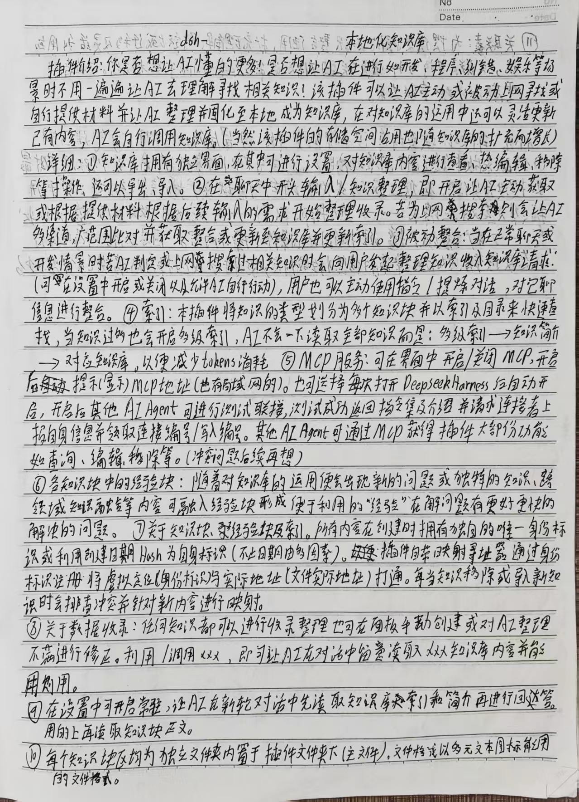

# 本地知识库（设计档案）

一个本地优先的知识库设计：知识和经验放在同一个库里，经验有生命周期（融合、跨域派生、被推翻），写入前由人拍板，被推翻的条目在你准备套用或遇到相似问题时作为警示出现，而不是消失。

## 怎么来的

从手稿开始，和 AI 来回讨论，一边写代码验证一边改设计，最后收敛成现在这套骨架。仓库里是设计文档和开发记录，不是成品。

## 里面有什么

- `docs/02_本地知识库插件.md` — 最初的设计说明
- `docs/06_开发会话开工卡.md` — 第一轮的范围和验收标准
- `docs/经验块规格.md` — 经验块的字段、动作、优先级
- `docs/术语与技术说明.md` — 这套设计自己的词与不变量（引用从这里开始）
- `docs/决策日志.md` — 实现过程中定下的细节
- `docs/开发日志/` — 两天的实施记录
- `assets/` — 手稿照片（知识库部分）

## 做到哪一步

本地版本已经能跑：存块、检索、经验记账、提议与拍板、面板界面，35 项测试通过。代码暂时不公开。

## 同类

MemGuard、Mem0、Zep、Letta 都在做 agent memory。这套设计的差别在于：准入交给人的共判，经验有复用记账和反例通道。

## 状态

暂时停更，没有时间表。Issues 已关闭，不接受 PR。

## 许可

文档与手稿：CC BY 4.0。
