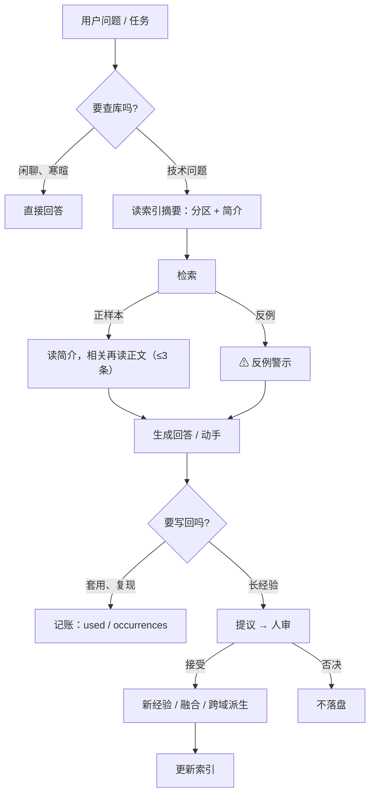
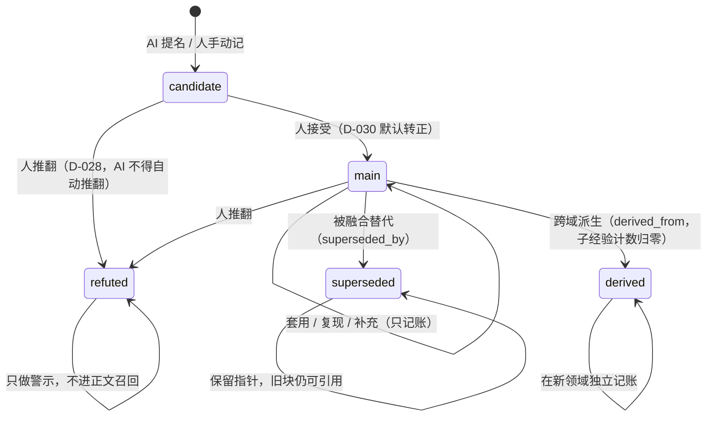

# 架构图

两张图：**一次问答的数据怎么流**、**一条经验的状态怎么变**。
都是 Mermaid，GitHub 直接渲染。

## 一、一次问答的数据流

对应实现：判定与检索在 `src/consult.mjs`，反例在 `src/warnings.mjs`，写回在 `src/experience.mjs`。

## 二、一条经验的状态

对应规格：`经验块规格.md` 的第 2、4、5 节；对应决定：D-009、D-010、D-028、D-030、D-032。
